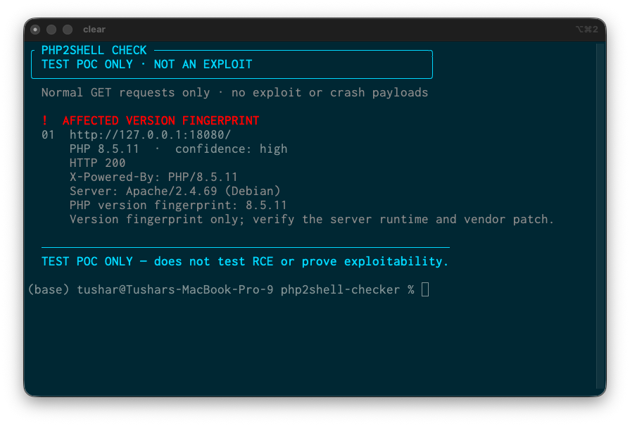
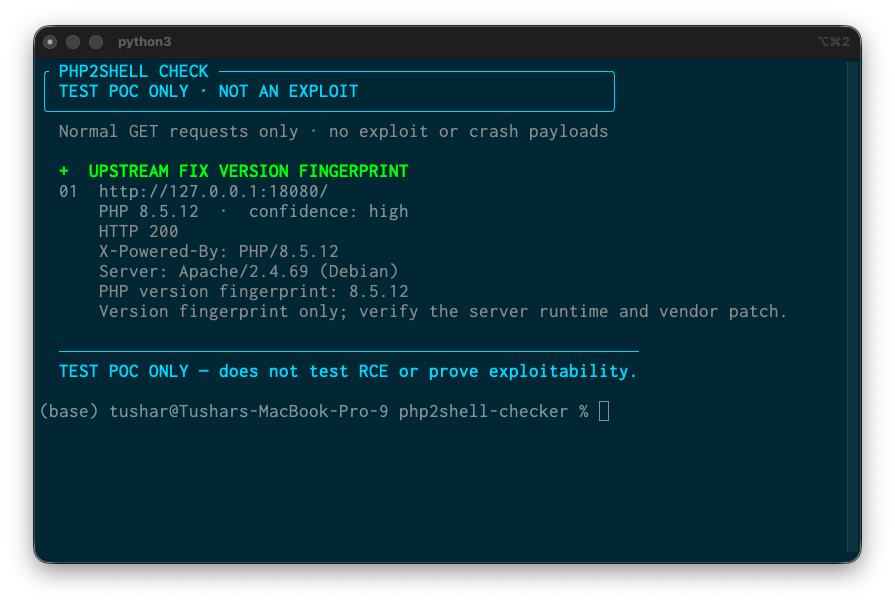

# PHP2Shell version fingerprint checker

> **Testing proof of concept only — not an exploit.** This project checks PHP version strings disclosed by a normal HTTP `GET` request and compares them with upstream fixed-version thresholds. It does not send exploit payloads, test remote code execution, or establish exploitability.

The checker is intended for systems you own or are authorized to assess. Remote results are only a version fingerprint: proxies, hidden headers, vendor backports, and differences between a probed endpoint and its production runtime can make the result inconclusive. Verify the actual web SAPI and package advisory with the system owner.

## What it does

- Makes an ordinary `GET` request and looks for explicit PHP version strings in common response headers or the response body.
- Classifies a disclosed version against upstream PHP fix thresholds for the affected branches.
- Checks the local PHP CLI when run with `--local` (this does not establish which runtime a web server uses).
- Uses a compact colored terminal display; red means the disclosed version is below the upstream threshold, green means at or above it, and amber means inconclusive or needs vendor verification.

## Requirements

- Python 3.10 or newer
- Docker Desktop with Docker Compose, for the isolated reproduction lab

## Run the checker

```sh
python3 php2shell_check.py https://your-authorized-host.example
python3 php2shell_check.py --local
python3 php2shell_check.py https://your-authorized-host.example --json
```

The HTTP probe is read-only and does not submit multipart forms, upload files, execute commands, exhaust memory, or intentionally crash workers. A result that finds no PHP version is **inconclusive**, not evidence that the site is safe.

## Reproduce the isolated Docker demonstration

The local lab deliberately exposes its PHP version so the check has deterministic input. It binds only to `127.0.0.1:18080` and serves a static PHP page that does not process uploads or execute commands.

```sh
bash lab/run_poc.sh
```

The script runs two sequential phases using official PHP Apache images:

1. `php:8.5.11-apache` — disclosed pre-fix upstream version; expected red classification.
2. `php:8.5.12-apache` — disclosed version at the upstream fix threshold; expected green classification.

Each phase records a transcript, response headers, and response body in `evidence/`, then stops the container. To run manually:

```sh
PHP_TAG=8.5.11 docker compose -f lab/docker-compose.yml up -d --pull always
python3 php2shell_check.py http://127.0.0.1:18080/
PHP_TAG=8.5.11 docker compose -f lab/docker-compose.yml down --remove-orphans

PHP_TAG=8.5.12 docker compose -f lab/docker-compose.yml up -d --pull always
python3 php2shell_check.py http://127.0.0.1:18080/
PHP_TAG=8.5.12 docker compose -f lab/docker-compose.yml down --remove-orphans
```

The screenshots below show the checker running in iTerm. They illustrate the classification change from the disclosed version only; they do not demonstrate exploitation or patch efficacy beyond that fingerprint.

### Local lab results

| Pre-fix upstream version | At-upstream-fix version |
|---|---|
|  |  |

## Interpretation and limitations

- A version below the upstream fixed release is an **affected-version fingerprint**, not proof that a particular deployment can be exploited.
- A version at or above that release is a **version fingerprint at the upstream fix threshold**, not proof of a vendor package's patch state.
- PHP vendors may backport fixes without changing the upstream-looking version string.
- A web server, proxy, pool, or endpoint may run a different PHP build from the one inferred by the response.
- No disclosed version means the check cannot classify the remote runtime.

Use vendor security advisories and inspect the actual deployed web runtime to make patch decisions.

## Sources

- [PHP security release announcement](https://www.php.net/archive/2026.php#2026-10-21-5)
- [PHP downloads and fixed releases](https://www.php.net/downloads.php)
- [UK NCSC summary](https://www.ncsc.gov.uk/news/critical-security-issue-affecting-php)
- [Red Hat advisory and exploitability notes](https://access.redhat.com/security/vulnerabilities/RHSB-2026-013)

## License

Licensed under the Apache License 2.0. See [LICENSE](LICENSE).


## Evidence records

The [evidence index](evidence/README.md) describes the captured transcripts, raw response headers, and response bodies in the [evidence folder](evidence/). The records come from the localhost-only Docker lab and show version fingerprinting behavior only. They do not demonstrate exploitation, RCE, or prove production patch status.
